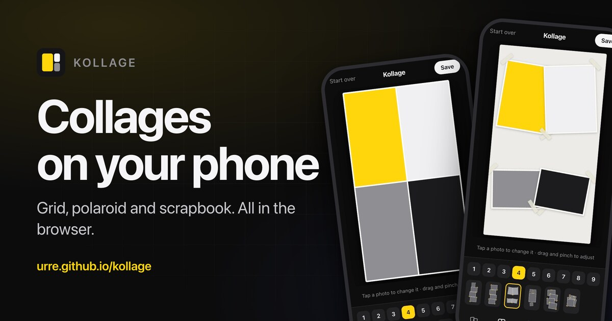

# Kollage

Make collages from your photos, right on your phone.

**[urre.github.io/kollage](https://urre.github.io/kollage/)**



Pick your photos, choose how many cells and which layout, drag and pinch each
photo into place, save as PNG or JPG — or share it straight to Photos.

- **Three kinds of collage:** grid, polaroid and scrapbook
- **Formats:** 9:16 (story), 4:5, 1:1, 3:2 and 16:9
- **Per photo:** pan, zoom and black and white
- **Export:** up to 3840×2160

## Privacy

Everything happens in the browser. No accounts, no server, no storage — your
photos are read, drawn and exported on the phone and never sent anywhere.

## Development

React 19 + TypeScript + Vite, with no runtime dependencies beyond React.

```bash
npm install
npm run dev        # vite --host on port 5180 — open it on your phone via this Mac's LAN IP
npm run build      # typecheck + build → dist/
```

A push to `main` builds and publishes to GitHub Pages.
