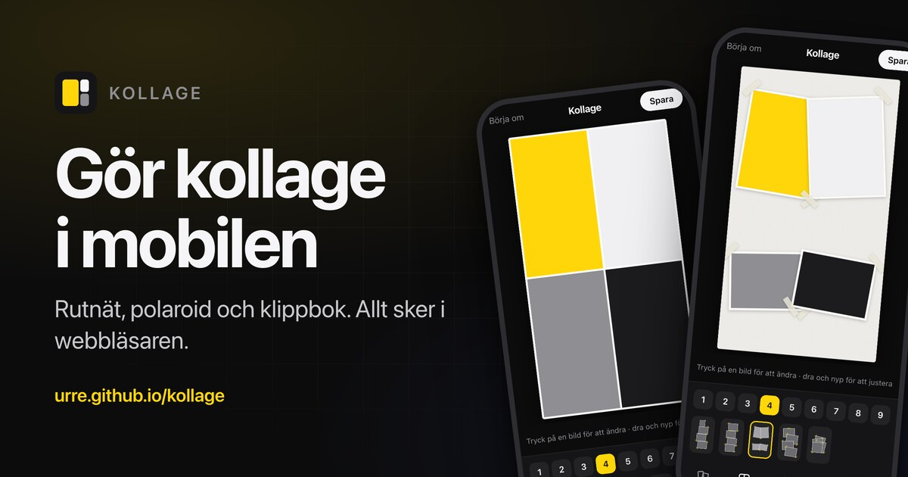

# Kollage

Gör kollage av dina bilder, direkt i mobilen.

**[urre.github.io/kollage](https://urre.github.io/kollage/)**



Välj bilder, bestäm hur många rutor och vilken layout, dra och nyp varje bild
på plats, spara som PNG eller JPG — eller dela direkt till Bilder.

- **Tre sorters kollage:** rutnät, polaroid och klippbok
- **Format:** 9:16 (story), 4:5, 1:1, 3:2 och 16:9
- **Per bild:** panorering, zoom och svartvitt
- **Export:** upp till 3840×2160

## Integritet

Allt sker i webbläsaren. Inga konton, ingen server, ingen lagring — bilderna
läses, ritas och exporteras på telefonen och skickas aldrig någonstans.

## Utveckling

React 19 + TypeScript + Vite, inga runtime-beroenden utöver React.

```bash
npm install
npm run dev        # vite --host på port 5180 — öppna via datorns IP i mobilen
npm run build      # typecheck + build → dist/
```

En push till `main` bygger och publicerar till GitHub Pages.
